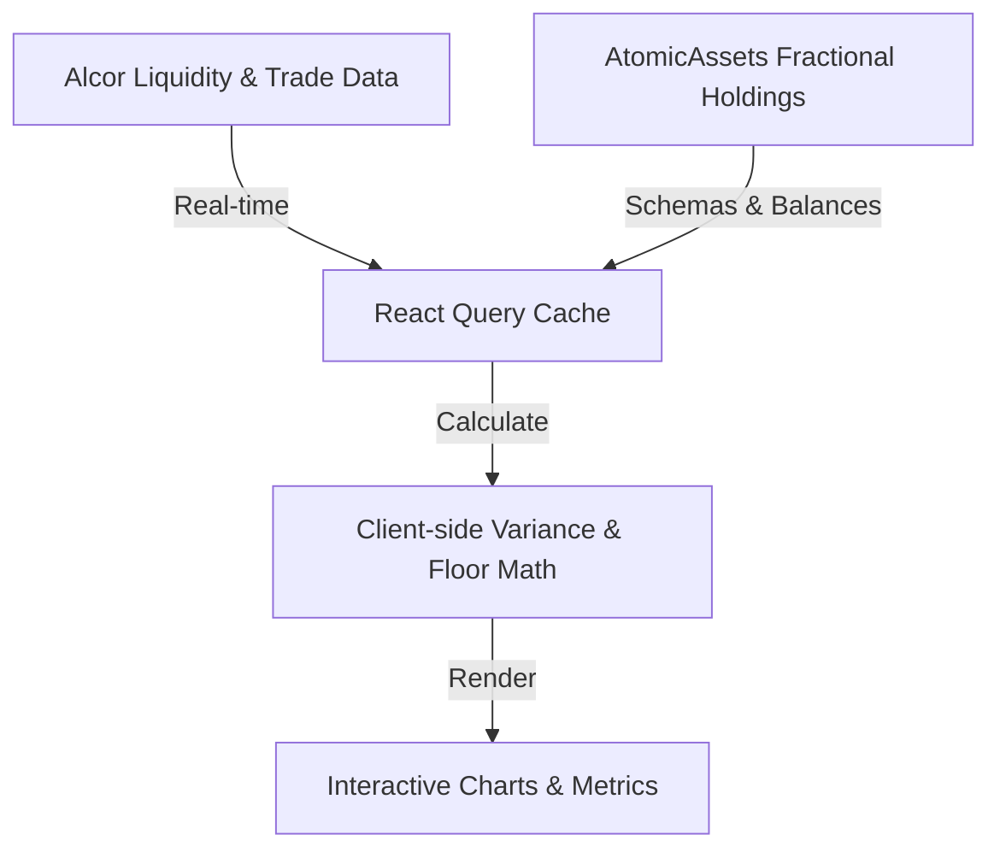

# wax-rwa-fractional-floor-index — RWA Fractional Floor Price Variance Index

> **Status:** 🔒 Private (In Development) | Target Public Release: August 2026  
> **Category:** Phygital (RWA) Redemptions & Supply-Chain Legibility  
> **Parent Catalog:** [pixel-journey/wax-ecosystem-blueprint-catalog](https://github.com/pixel-journey/wax-ecosystem-blueprint-catalog)

**One-sentence goal:** An elegant charting dashboard that evaluates and visualizes the spot floor price variance and liquidity dynamics of high-value physical goods that have been fractionalized across liquid on-chain asset pools, giving investors and collectors transparent insight into RWA valuation stability on WAX.

---

## 1. Overview & Goal

This blueprint provides a professional-grade analytics view for fractionalized real-world assets (RWAs) on WAX. It shows how the "floor" of physical items (via fractional tokens or shares) moves in real time against on-chain liquidity, helping users understand true value, volatility, and arbitrage opportunities.

- **Why it matters:** Fractional RWAs are emerging on WAX. Transparent floor variance tracking builds trust and enables sophisticated trading/hedging strategies.
- **Public infrastructure only:** AtomicAssets for fractional token schemas and holdings, Alcor/Hyperion for liquidity and price data, client-side variance calculations. No custom contracts.
- **Target users:** RWA investors, fractional ownership platforms, high-value phygital collectors, market makers, analysts.
- **Success metrics:** "See real-time fractional floor variance and liquidity depth in <2s", "Identify stable vs volatile fractional assets instantly", "Support data-driven investment decisions in RWAs".

---

## 2. Concepts & Inspiration

- **Core concepts:** Fractionalization splits ownership of physical assets into on-chain tokens. Floor price = lowest ask or last trade for fractional shares. Variance = how much the implied physical value fluctuates. Liquidity depth from Alcor pools provides stability signals.
- **Pain points:** Fractional RWA prices can be opaque or manipulated. Investors lack beautiful tools to see true variance vs. underlying physical value.
- **Inspirations:** Traditional stock fractional share dashboards (e.g. Robinhood, Public), real estate fractional platforms (e.g. Fundrise analytics), crypto index charts. Web3: on-chain transparency + beautiful variance viz.
- **Cross-references:** Complements `wax-phygital-wear-and-tear-ledger` (condition affects value), `wax-collection-velocity-scatter-plot`, and Alcor visualizers. Fits with innovative Category 1 and 7 (compliance/accounting).

---

## 3. Design Specifications (Pixel Journey Standards)

### 3.1 Visual & Interaction Design
- Clean financial dashboard with main variance chart (line or area) + liquidity depth heatmap.
- Sidebar: Asset selector, time range, key metrics (current floor, 24h variance, liquidity score).
- Color: Professional blues/greens for positive stability, amber/red for high variance. Clean modern Web3 aesthetic.
- Micro-interactions: Hover shows exact block/timestamp and underlying data points.
- Responsive: Excellent on desktop for analysis; mobile-friendly summary cards.

### 3.2 Key Views / Components
- `FractionalFloorDashboard.tsx` — Main charting area.
- `VarianceLineChart.tsx` — Interactive line/area chart with annotations.
- `LiquidityDepthHeatmap.tsx` — Visual depth across price levels.
- `RWAMetricsSidebar.tsx` — Live KPIs and asset health indicators.

### 3.3 Accessibility (A11y) & Inclusive Design
- WCAG 2.2 AA: High contrast charts (pattern fills + labels), keyboard navigation, screen reader descriptions of trends.
- Colorblind-safe palettes.
- Data table fallback view for all charts.

### 3.4 Performance & Optimization Targets
- Fast rendering with Recharts or lightweight Canvas for heatmaps.
- Efficient data fetching via React Query + caching.
- Responsive design with progressive enhancement.

---

## 4. Technical Architecture

### 4.1 Core Tech Stack
- Next.js 15 + TypeScript + Tailwind + shadcn/ui + Recharts / Tremor
- @tanstack/react-query
- Alcor public endpoints + Hyperion for trades/liquidity
- AtomicAssets for fractional token data
- date-fns for time handling

### 4.2 Data Flow Diagram


### 4.3 Folder Structure
```
app/
├── (dashboard)/page.tsx
├── components/
│   ├── charts/
│   │   ├── VarianceLineChart.tsx
│   │   └── LiquidityDepthHeatmap.tsx
│   └── sidebar/
│       └── RWAMetricsSidebar.tsx
├── hooks/useFractionalFloor.ts
├── lib/wax/
│   ├── alcor-client.ts
│   └── variance-calculator.ts
└── types/rwa.ts
```

### 4.4 Security & Privacy
- Purely public data. No wallet connection required for viewing (optional for personal holdings overlay).

---

## 5. Implementation Examples & Code Snippets

**Core hook**
```ts
// hooks/useFractionalFloor.ts
export function useFractionalFloor(asset: string) {
  return useQuery({
    queryKey: ['fractional-floor', asset],
    queryFn: async () => {
      const liquidity = await fetchAlcorLiquidity(asset);
      const holdings = await fetchAtomicFractional(asset);
      return computeFloorVariance(liquidity, holdings);
    }
  });
}
```

**Variance calculation example**
```ts
function computeFloorVariance(liquidityData: any, holdings: any) {
  // Calculate implied physical floor from fractional price * total shares
  // Then compute variance over time windows
  return { currentFloor, variance24h, liquidityScore };
}
```

---

## 6. Demo & Testing
- Mock data with sample fractional luxury watch or art piece.
- Live mode pulling real Alcor + Atomic data.
- Chart interaction tests (zoom, hover details).
- Playwright flows for asset switching and metric updates.

---

## 7. Roadmap
Phases follow standard: data layer → charting components → polish & a11y → full documentation.

Future: Alerts for high variance, correlation with physical condition ledger, exportable analyst reports.

---

## 8. Visual References
> Professional financial terminal meets beautiful Web3 explorer. Think TradingView clarity + modern dashboard polish (e.g. Dune Analytics or Glassnode style). Clean lines, subtle animations on data updates, excellent typography for numbers.

---

## 9. Related Blueprints
- `wax-phygital-wear-and-tear-ledger` — Condition data can inform floor stability.
- Alcor visualizers and marketplace analytics tools.
- Compliance/accounting blueprints for deeper financial forensics.

---

## 10. License & Credits
MIT. Built for transparent RWA markets on WAX public infrastructure.

**Pixel Journey — Beautiful interfaces for public blockchain data.**
